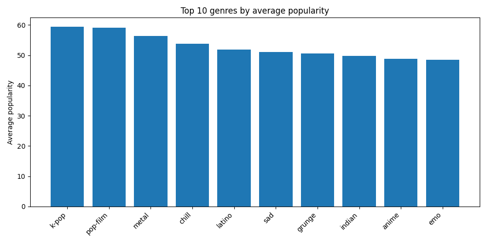

# Overview

SpotifyML is a Python program that explores the Spotify Tracks dataset from Kaggle (114,000 tracks, each with Spotify audio features, a popularity score, and a genre label) and answers two questions: which audio features actually track with popularity, and can tracks be grouped into vibe clusters that power a simple song suggester?

How it works: the raw data repeats tracks under multiple genres, so the program first deduplicates by track_id (keeping the first row), drops rows with missing values, and drops rows with impossible zeros for tempo and time signature, leaving 89,578 unique tracks. For the popularity question it computes the correlation of each of nine audio features with popularity and the average popularity of every genre. For the suggester it scales the nine features, runs K-Means clustering with k = 5, and recommends the 5 tracks closest to a seed track in scaled feature space. The suggester is tested three ways: an ear test on the recommendations, a distance test against random tracks, and a genre test, since the model never sees the genre label.

Final run results: popularity averages 33.2 and 10.5% of tracks sit at exactly 0. No audio feature predicts popularity well: loudness is the strongest positive correlation (+0.07) and instrumentalness the strongest negative (-0.13). Average popularity varies a lot by genre anyway, led by k-pop (59.4), pop-film (59.1), and metal (56.4), with iranian (2.2) at the bottom. For the seed track "Unholy (feat. Kim Petras)," the 5 recommendations averaged a feature distance of 0.58 versus 2.77 for random tracks, so the suggester finds genuinely similar-sounding songs, but 0 of the 5 shared the seed's dance genre: it matches sound, not genre labels.

My purpose in writing this was to run a complete, honest machine learning pipeline on real data: cleaning, scaling, clustering, and a recommender, with tests that could have proven the idea wrong.

[Software Demo Video](https://youtu.be/0CHnTdqXw0Y)

# Development Environment

* Python 3.13 with pandas, matplotlib, and scikit-learn
* VS Code
* Git and GitHub for version control

# Useful Websites

* [Spotify Tracks Dataset (Kaggle)](https://www.kaggle.com/datasets/maharshipandya/-spotify-tracks-dataset) - the dataset used for this project
* [scikit-learn KMeans documentation](https://scikit-learn.org/stable/modules/generated/sklearn.cluster.KMeans.html) - how the clustering algorithm and its settings work
* [pandas documentation](https://pandas.pydata.org/docs/) - the data cleaning, grouping, and correlation operations

# Future Work

* Let the user type in any seed track instead of using a fixed demo seed
* Try larger values of k and compare how coherent the clusters feel
* Weight the features by how much each one matters instead of treating all nine equally
* Show the recommended tracks with album art and preview links
